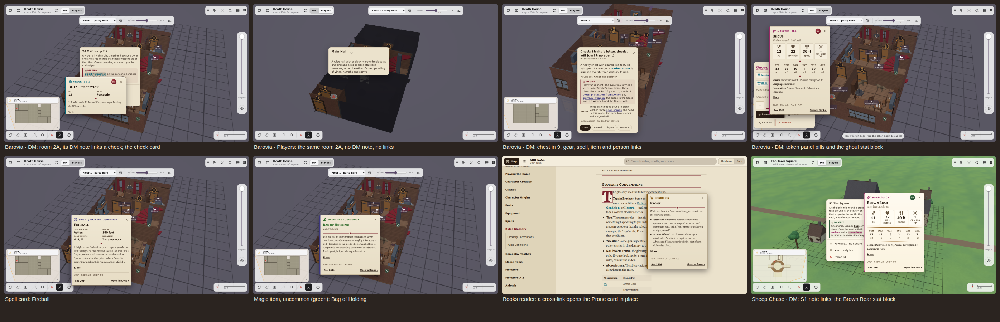

# 0.1.0: D&D rule tooltips and the SRD books

Released 2026-10-12. The contact sheet shows the highlights:

| Screenshot | What it shows |
|---|---|
| 01–09 | One card of each kind: spell, condition, monster stat block, magic items of two rarities, rule, damage type, check, dice |
| 10 | Death House room 2A as the DM sees it: its DM note links a check |
| 11–12 | Chest 9's DM note with gear, spell, item and person links; the Bless card |
| 13–14 | The token panel and the ghoul's stat block |
| 15 | The same room 2A in Players mode: no DM note, no links |
| 16–17 | The Books reader, and a cross-link opening a card in place |
| 18–19 | A Wild Sheep Chase: the square's note links, and the brown bear's stat block |
