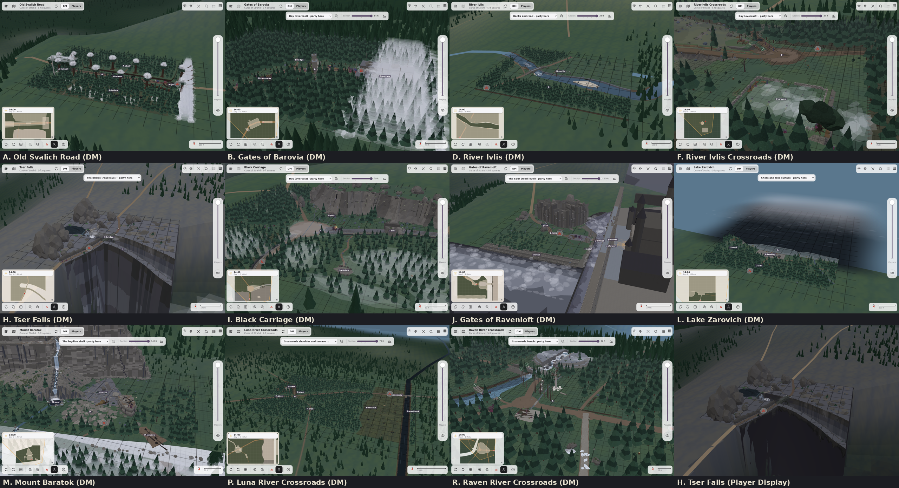

# 0.2.0: Chapter 2 sites

Released 2026-10-13. Eleven places in the Svalich Woods that had no real map are now full outdoor maps, each one different.

| Screenshot | What it shows |
|---|---|
| 01 | A. Old Svalich Road: a tunnel of leaning giant pines, with the road leaving into the Mists |
| 02 | B. Gates of Barovia |
| 03 | D. River Ivlis |
| 04 | F. River Ivlis Crossroads and the gallows |
| 05 | H. Tser Falls: a cliff over Tser Pool, with the valley in view |
| 06 | I. The Black Carriage |
| 07 | J. Gates of Ravenloft and the drawbridge |
| 08 | L. Lake Zarovich under its mist |
| 09 | M. Mount Baratok |
| 10 | P. Luna River Crossroads |
| 11 | R. Raven River Crossroads |
| 12 | Tser Falls on the Player Display |

All shots are the DM view at desktop size (1280x860), except 12. They were taken from the published 0.2.0 build.

Known limits: after one fix round, A, B, D, F, H, I, J, L and M still have 23 small defects between them, and some show here. For example, the Mists wall on the Old Svalich Road is see-through. They are listed in mistLAB's `docs/CHANGELOG.md` under 0.2.0.
