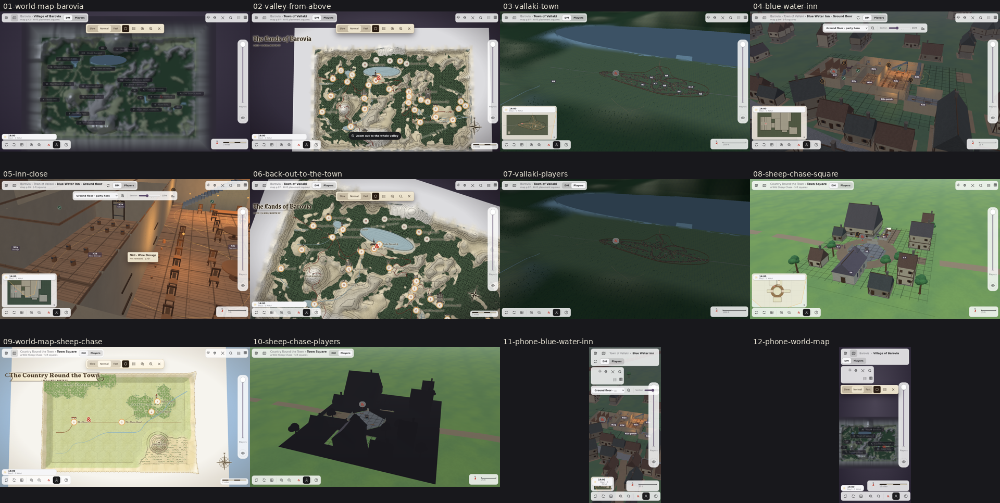

# 0.3.1: One world to zoom through

Released 2026-10-13 (0.3.0) and 2026-10-14 (0.3.1). Every map of *Curse of Strahd* now hangs in one continuous valley: the World map button shows the region from above with its places, a zoom from the whole valley runs into Vallaki, into the Blue Water Inn and down to a room, and back out again, with the breadcrumb and Back at every level. 0.3.1 added the local terrain joins and the compass that faces north on a click, a tap or a key.

| Screenshot | What it shows |
|---|---|
| 01 | The World map button: the valley from above with its places, opened from the Village of Barovia |
| 02 | The whole valley from above, zoomed out from Vallaki |
| 03 | Vallaki town, framed for the table |
| 04 | The Blue Water Inn, entered from the town |
| 05 | Inside the inn: the taproom and the wine store, with a room's card |
| 06 | Zooming out from the inn past the town to the inked Lands of Barovia with its hex grid |
| 07 | Vallaki in Players view |
| 08 | A Wild Sheep Chase: the square |
| 09 | The Sheep Chase campaign's own world map |
| 10 | The square in Players view |
| 11 | The Blue Water Inn on a phone (390x844) |
| 12 | The World map on a phone |

Desktop shots are the DM view at 1366x768 unless the row says otherwise. They were taken from the 0.3.2 build (the nested world is unchanged since 0.3.1) with software rendering; the laptop's GPU draws the same frames faster.
