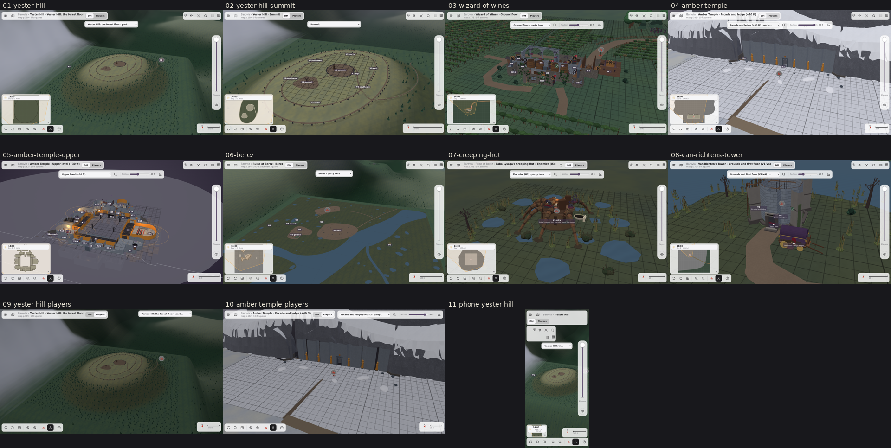

# 0.3.2: Map smoothing, unfinished maps

Released 2026-10-18. The four *Curse of Strahd* maps that were still rough are finished: Yester Hill climbs stretch by stretch to the summit circle and its fog wall is a soft bank of mist instead of cotton; the Amber Temple's mountain is closed round it with the upper and lower levels visible under a cut in the snow; the Wizard of Wines has its cellar; Berez, the creeping hut and Van Richten's tower are finished.

| Screenshot | What it shows |
|---|---|
| 01 | Yester Hill: the forest floor level, the tree ring and the mist bank behind the hill |
| 02 | Yester Hill: the summit circle |
| 03 | The Wizard of Wines |
| 04 | The Amber Temple: the facade and ledge under the mountain |
| 05 | The Amber Temple: the upper level, no longer buried |
| 06 | The Ruins of Berez |
| 07 | The creeping hut |
| 08 | Van Richten's tower |
| 09 | Yester Hill in Players view |
| 10 | The Amber Temple in Players view |
| 11 | Yester Hill on a phone (390x844) |

Desktop shots are the DM view at 1366x768 unless the row says otherwise, taken from the published 0.3.2 build with software rendering. The remaining nits are listed in mistLAB's `docs/handoff/item7-open.md` and `docs/CHANGELOG.md` under 0.3.2.
