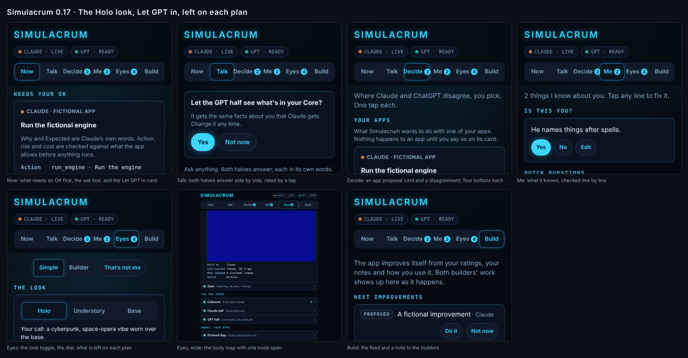

# Simulacrum 0.17: The Holo look, Let GPT in, left on each plan

Captured 2026-10-12 with placeholder content (the page's test fixtures), never Matt's data. The contact sheet shows the highlights:

| Screenshot | What it shows |
|---|---|
| /tmp/claude-0/-home-claude-simulacrum/98a3620a-d07b-5a1f-a712-d672301d4703/scratchpad/rel/01-now.png | Now: what needs an OK first, the ask box, and the Let GPT in card |
| /tmp/claude-0/-home-claude-simulacrum/98a3620a-d07b-5a1f-a712-d672301d4703/scratchpad/rel/02-talk.png | Talk: both halves answer side by side, rated by a tap |
| /tmp/claude-0/-home-claude-simulacrum/98a3620a-d07b-5a1f-a712-d672301d4703/scratchpad/rel/03-decide.png | Decide: an app proposal card and a disagreement, four buttons each |
| /tmp/claude-0/-home-claude-simulacrum/98a3620a-d07b-5a1f-a712-d672301d4703/scratchpad/rel/04-me.png | Me: what it knows, checked line by line |
| /tmp/claude-0/-home-claude-simulacrum/98a3620a-d07b-5a1f-a712-d672301d4703/scratchpad/rel/05-eyes-look.png | Eyes: the look toggle, the dial, what is left on each plan |
| /tmp/claude-0/-home-claude-simulacrum/98a3620a-d07b-5a1f-a712-d672301d4703/scratchpad/rel/06-eyes-body.png | Eyes, wide: the body map with one node open |
| /tmp/claude-0/-home-claude-simulacrum/98a3620a-d07b-5a1f-a712-d672301d4703/scratchpad/rel/07-build.png | Build: the feed and a note to the builders |
